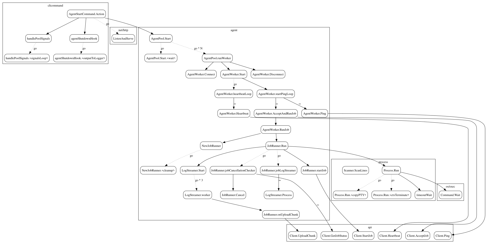

# Agent start

`buildkite-agent` does a lot of things, and so it ends up running a lot of 
different goroutines. This is an attempt to document what is going on at the goroutine level.

The diagram below depicts the (incomplete) call graph that runs when running
`buildkite-agent start`. Packages are shown as surrounding rectangles.
Solid arrows denote regular function calls. Dotted arrows (labelled "go") are
goroutine calls. Some anonymous funcs are given names for the purpose of the
diagram (in angle brackets).



`buildkite-agent start` effectively begins at the `Action` in `AgentStartCommand`. 
Already there are four different goroutines running: one for handling signals,
one that waits to run the shutdown hook, one for the inbuilt HTTP server, and
finally the main goroutine continues to start the `AgentPool`.

`AgentPool` manages `AgentWorker`s - the number of workers is given by the
concurrency config option or flag. `AgentPool` also spins up one other 
goroutine which waits for all the workers to finish, then closes a channel.
The effect is that `AgentPool` returns either `nil` once all workers have 
stopped without error, or the first non-nil error.

Once all workers have registered, the once-per-process `agent-startup` hook runs
before the `AgentPool` starts. The `agent-startup` and `agent-shutdown` hooks
receive `BUILDKITE_AGENT_IDS` and `BUILDKITE_AGENT_NAMES` as comma-separated
lists in spawn order, allowing hook scripts to identify the registered spawned
agents without querying the API.

After connecting, `AgentWorker` runs two main goroutines: one periodically 
calls `Heartbeat`, the other more frequently calls `Ping`. `Ping` is how the 
worker discovers work from the API.

Once a job has been accepted, the `AgentWorker` fires up a `JobRunner` to run
it. Each `JobRunner` starts several goroutines that handle various tasks:

* Processing chunks of log output from the job
* Streaming chunks of logs up to the API
* Streaming header times up to the API
* Periodically checking with the API if the job is cancelled
* Waiting for the job to be over to mark the job as completed

The core of the job runner is running a `Process`, which itself spins up a few
helper goroutines:

* Copying PTY output
* Waiting on context cancellation in order to hard-terminate the process

## Experimental host-bound worker sessions

`--experiment host-bound-sessions` enables an **agent-side protocol prototype**.
The production Agent API does not yet implement this enrollment contract. Do not
enable this against production expecting host-bound authentication to work.
Existing registration-token authentication is unchanged without the new options.

The agent separates the hardware key from enrollment authorization. A provisioner
first creates a key on the new host and obtains its public JWK and RFC 7638
SHA-256 thumbprint (`jkt`):

```sh
buildkite-agent identity --experiment host-bound-sessions --create \
  --key-uri 'tpmkms:name=buildkite-agent;device=/dev/tpmrm0;storage-directory=/var/lib/buildkite-agent/identity'
```

The hidden `identity` command prints public JSON only. Omit `--create` to inspect
an existing key. `start` only opens existing keys; it never replaces a missing key
or falls back to software. Each replacement instance should create a new key;
keys must not be baked into machine images. This slice does not provide key
deletion or automatic recovery; the provisioner owns their lifecycle.

Every process start needs a fresh enrollment grant, even when restarting on the
same host with the same persistent key. The registration credential is held only
in memory. If enrollment succeeds but its response is lost, the provisioner must
issue another grant; the agent does not blindly replay a consumed grant.

Supported Smallstep KMS URI backends are:

* `tpmkms`, with an explicit `storage-directory` and access to the TPM device.
* `mackms`, with `se=true` and without biometric prompts. This requires a CGO
  build, Secure Enclave availability, and appropriate macOS signing/entitlements.
  The agent verifies the resolved private key's Secure Enclave token attribute
  and pins signing to its public-key hash; the URI flag alone is not trusted.
  The current release build script disables CGO, so this prototype requires a
  custom macOS build; it does not change release packaging.
* `capi`, with `provider=Microsoft Platform Crypto Provider` and an explicit
  `key=...` container, for example
  `capi:provider=Microsoft Platform Crypto Provider;key=buildkite-agent;store-location=machine`.
  Certificate-only lookup is rejected because its private key can belong to a
  software provider regardless of the provider selected in the URI.

A trusted provisioner authorizes the public key for a cluster/queue and supplies
a short-lived, single-use grant **bound to that thumbprint**. How the provisioner
obtains the grant is outside the agent; a hostname or self-reported hardware
backend is not enrollment authorization or hardware attestation.

```sh
buildkite-agent start --experiment host-bound-sessions \
  --host-key-uri 'tpmkms:name=buildkite-agent;device=/dev/tpmrm0;storage-directory=/var/lib/buildkite-agent/identity' \
  --enrollment-token file:///run/buildkite-agent/enrollment-grant
```

The options can also be supplied through `BUILDKITE_AGENT_HOST_KEY_URI` and
`BUILDKITE_AGENT_ENROLLMENT_TOKEN`. Grant input must be a `file://` or `fd://`
reference, not a plaintext argument or environment value. Do not supply `--token`
with these options. `--debug-http` and `--acquire-job` are unsupported in this
experimental mode. Identity configuration is not passed to job subprocesses.

### Proposed server contract

The agent redeems the grant once with `POST enroll` relative to its configured
Agent API endpoint (normally `/v3/enroll`). It sends `Authorization: Token <grant>`
and an ES256 DPoP proof without `ath`. The server must verify the grant's scope,
expiry and key binding and atomically consume it. The response contains
`access_token`, `token_type: "DPoP"` and `dpop_jkt`. This credential permits
registering the process's workers, not arbitrary fleet enrollment.

Each worker then calls `POST register` with that bound credential. Registration
must return its own session `access_token`, `token_type: "DPoP"` and the same
`dpop_jkt`. Missing or mismatched confirmation is an error, never a downgrade.
Bound requests use `Authorization: DPoP <token>` and an RFC 9449 proof containing
the token hash, method, public URL without query/fragment, time and fresh `jti`.
The server must enforce those fields, token scope and replay prevention on both
HTTP and streaming APIs, including all legacy token-authentication paths.

The client caches server nonces and retries a nonce challenge at most once when
the request body can be replayed. It signs only HTTPS requests to its configured
API origin; cross-origin redirects fail. An authenticated registration/ping
response may explicitly select a new endpoint, preserving the host key.

This slice does **not** implement session renewal, grant issuance, attestation,
job-token binding or a local operation broker. Existing job tokens remain
portable legacy credentials. Jobs must receive their own token: the agent rejects
a job without one rather than exporting a bound worker session. The host signer
is removed from the job API client. Protecting the host process and key from job
code still requires OS-level isolation; a non-exportable key alone is insufficient.
