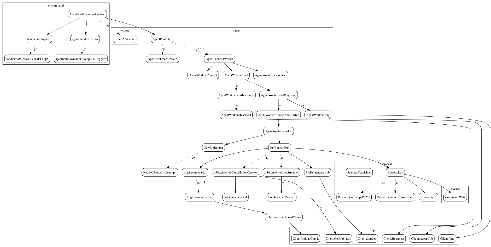

# Agent start

`buildkite-agent` does a lot of things, and so it ends up running a lot of 
different goroutines. This is an attempt to document what is going on at the goroutine level.

The diagram below depicts the (incomplete) call graph that runs when running
`buildkite-agent start`. Packages are shown as surrounding rectangles.
Solid arrows denote regular function calls. Dotted arrows (labelled "go") are
goroutine calls. Some anonymous funcs are given names for the purpose of the
diagram (in angle brackets).

`buildkite-agent start` effectively begins at the `Action` in `AgentStartCommand`. 
Already there are four different goroutines running: one for handling signals,
one that waits to run the shutdown hook, one for the inbuilt HTTP server, and
finally the main goroutine continues to start the `AgentPool`.

`AgentPool` manages `AgentWorker`s - the number of workers is given by the
concurrency config option or flag. `AgentPool` also spins up one other 
goroutine which waits for all the workers to finish, then closes a channel.
The effect is that `AgentPool` returns either `nil` once all workers have 
stopped without error, or the first non-nil error.

Once all workers have registered, the once-per-process `agent-startup` hook runs
before the `AgentPool` starts. The `agent-startup` and `agent-shutdown` hooks
receive `BUILDKITE_AGENT_IDS` and `BUILDKITE_AGENT_NAMES` as comma-separated
lists in spawn order, allowing hook scripts to identify the registered spawned
agents without querying the API.

After connecting, `AgentWorker` runs two main goroutines: one periodically 
calls `Heartbeat`, the other more frequently calls `Ping`. `Ping` is how the 
worker discovers work from the API.

Once a job has been accepted, the `AgentWorker` fires up a `JobRunner` to run
it. Each `JobRunner` starts several goroutines that handle various tasks:

* Processing chunks of log output from the job
* Streaming chunks of logs up to the API
* Streaming header times up to the API
* Periodically checking with the API if the job is cancelled
* Waiting for the job to be over to mark the job as completed

### Agent-side bootstrap hooks

The agent runs `pre-bootstrap` and `post-bootstrap` from its configured hooks
path, using its hooks shell. These are agent hooks, not repository or plugin
hooks. Their output goes to the agent log, not the job log.

`pre-bootstrap` can reject a job before its bootstrap starts. After a bootstrap
attempt returns, `post-bootstrap` runs even if starting the process failed or
cancellation, a timeout, or agent stop caused it to be killed with SIGKILL. It
does not run for jobs rejected before the bootstrap attempt.

The agent uploads the final bootstrap logs before running `post-bootstrap`, so
diagnostics remain visible while cleanup runs. `post-bootstrap` finishes before
the agent reports the job finished or removes the job's environment files.
This lets operators clean up resources left behind
by a killed bootstrap before the worker can accept another job. Its exit status
does not change the job result. It is not cancelled with the job and has no
deadline: it blocks the worker from accepting another job until it exits. A
command stuck on a hung Docker daemon can therefore block the worker indefinitely.
Operators must bound their own cleanup commands, for example with `timeout`.
The hook cannot run if the agent itself is killed or the host shuts down, and external
service shutdown deadlines can interrupt it. With multiple workers on one host,
hooks can overlap; cleanup must target only the resources belonging to that job.

Both hooks inherit the agent's environment, plus these trusted values (not the
job's environment):

* `BUILDKITE_JOB_ID`
* `BUILDKITE_ENV_FILE` and `BUILDKITE_ENV_JSON_FILE`
* `BUILDKITE_AGENT_ACCESS_TOKEN` (the job API token) and `BUILDKITE_AGENT_ENDPOINT`
* `BUILDKITE_NO_HTTP2`, `BUILDKITE_AGENT_DEBUG`, and `BUILDKITE_AGENT_DEBUG_HTTP`

The environment files contain untrusted job values. Read them as data; do not
source them into a privileged cleanup shell.

`post-bootstrap` also receives `BUILDKITE_BOOTSTRAP_EXIT_STATUS`,
`BUILDKITE_BOOTSTRAP_SIGNAL`, and `BUILDKITE_BOOTSTRAP_SIGNAL_REASON`, matching
the result reported to the API. A signal exit has status `-1`; signal and reason
are empty when absent. Reasons include `cancel` (also used for job timeouts),
`agent_stop`, and `process_run_error`.

### Bootstrap process

The core of the job runner is running a `Process`, which itself spins up a few
helper goroutines:

* Copying PTY output
* Waiting on context cancellation in order to hard-terminate the process
